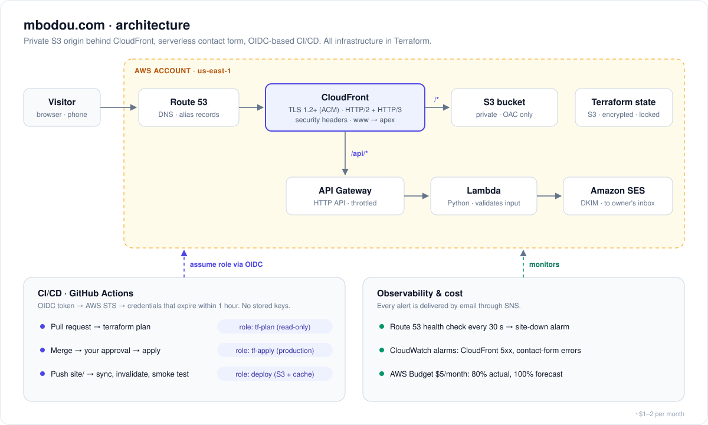
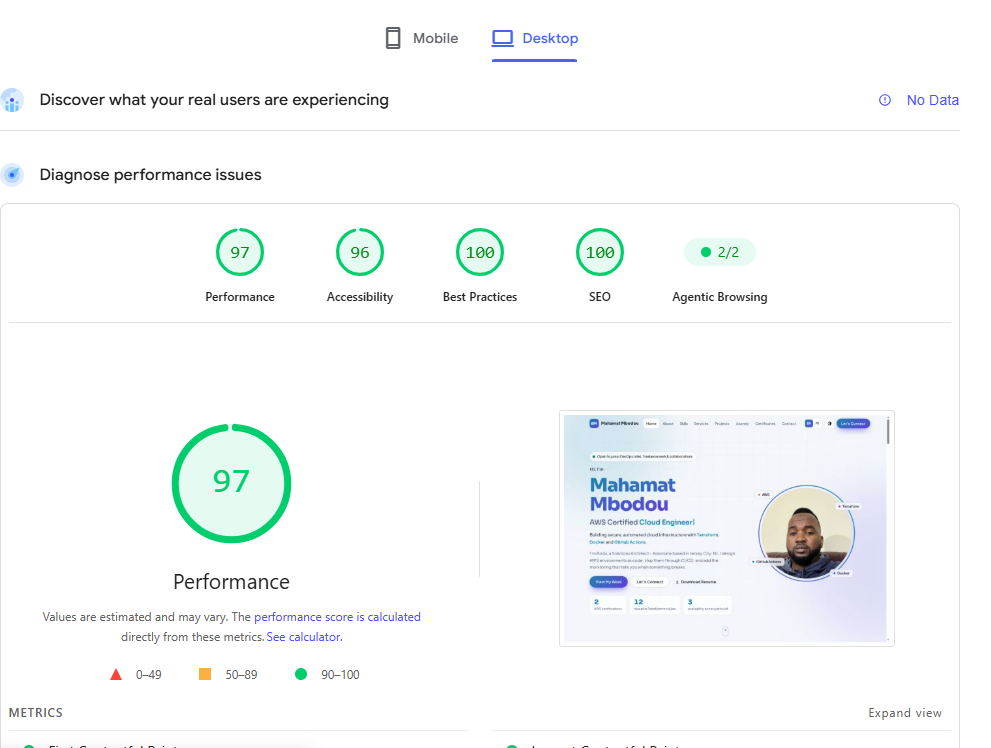

<div align="center">

# mbodou.com

**A production-grade personal website on AWS, built entirely with Terraform and shipped through approval-gated CI/CD.**

[](https://mbodou.com)
[](https://github.com/mahamatmbodou33/portfolio-site/actions/workflows/deploy-site.yml)
[](https://github.com/mahamatmbodou33/portfolio-site/actions/workflows/terraform.yml)


</div>

---

## Overview

The site itself is static, but everything around it is run like a production service: a private origin
behind a CDN, a serverless contact form, strict security headers, uptime and error alarms, a cost budget,
and two GitHub Actions pipelines that deploy to AWS **without any stored credentials**.
Every infrastructure change goes through a pull request, a reviewed `terraform plan`, and a manual approval.

**Contents:** [Architecture](#architecture) · [Highlights](#highlights) · [Security](#security) ·
[CI/CD](#cicd) · [Monitoring and cost](#monitoring-and-cost) · [Results](#results) ·
[Problems I debugged](#problems-i-debugged) · [Repository layout](#repository-layout) · [Run it yourself](#run-it-yourself)

## Architecture

<p align="center">
  
</p>

| Layer | Services |
| --- | --- |
| Hosting | Amazon S3 (private), CloudFront, ACM, Route 53 |
| Contact form | API Gateway (HTTP API), AWS Lambda (Python 3.13, arm64), Amazon SES |
| Monitoring | Route 53 health check, CloudWatch alarms, SNS, AWS Budgets |
| Delivery | Terraform with S3 remote state, GitHub Actions with OIDC |

## Highlights

| What | Why it matters |
| --- | --- |
| **Private origin** | The bucket blocks all public access. CloudFront signs requests with Origin Access Control, and the bucket policy only trusts this one distribution. Opening the bucket URL directly returns `AccessDenied`. |
| **No stored AWS keys** | GitHub Actions gets short-lived credentials through OIDC. Three IAM roles each trust exactly one kind of run. |
| **Approval-gated applies** | Pull requests run a read-only `terraform plan`. After merge, `terraform apply` waits in a protected `production` environment for manual approval. |
| **Alerts that were tested** | Health check, CloudFront and contact-form alarms email me through SNS. Delivery was verified end to end by forcing an alarm. |
| **About $1–2 a month** | Static hosting stays within CloudFront's always-free tier. A $5 AWS Budget alerts at 80% of actual and 100% of forecast spend. |

## Security

Every response carries these headers, set at the edge by a CloudFront response headers policy:

| Header | Protects against |
| --- | --- |
| `Strict-Transport-Security` | protocol downgrade; HTTPS only for 2 years, preload-ready |
| `Content-Security-Policy` | injected scripts (XSS); only this site and Google Fonts, no inline code |
| `X-Frame-Options: DENY` | clickjacking |
| `X-Content-Type-Options: nosniff` | MIME-type confusion |
| `Referrer-Policy` | leaking full URLs to other sites |
| `Permissions-Policy` | unused browser features (camera, microphone, location, payment) |

- TLS 1.2+ only, HTTP/2 and HTTP/3. `http://` and `www.` redirect to `https://mbodou.com`.
- The contact form API is reached only through CloudFront on the same domain, so no CORS is needed.
- The Lambda validates and size-limits input, strips characters that could inject email headers,
  silently drops bot submissions caught by a honeypot field, and runs with least-privilege IAM:
  it can only write its own logs and send email from `noreply@mbodou.com`.
- API Gateway throttles the contact endpoint to 2 requests per second (burst 5).

## CI/CD

```
Website          push to main ──► S3 sync ──► CloudFront invalidation ──► live smoke test
Infrastructure   pull request ──► terraform plan (read-only) ──► review ──► merge
                     ──► approval in "production" ──► terraform apply
```

| IAM role | Trusted for (OIDC `sub`) | Permissions |
| --- | --- | --- |
| `portfolio-gha-deploy` | pushes to `main` | write site files, invalidate CloudFront |
| `portfolio-gha-tf-plan` | pull requests | read-only, plus the state lock file |
| `portfolio-gha-tf-apply` | `production` environment | apply Terraform |

The trust policies use GitHub's immutable subject format, `repo:owner@<owner-id>/repo@<repo-id>:...`,
so a deleted and re-created repository with the same name cannot assume these roles.
The deploy pipeline ends with a smoke test that fails the run if the live site loses its security headers or content.

## Monitoring and cost

| Signal | Alert |
| --- | --- |
| Route 53 HTTPS health check every 30 s | site-down alarm, plus a recovery email |
| CloudFront 5xx error rate above 5% | email |
| Contact-form API returning 5xx | email (a message may not have been delivered) |
| Monthly AWS spend | 80% of $5 actual, 100% forecast |

Log groups keep 30 days of logs. Lambda runs on arm64 at 128 MB.

## Results

<!-- Add your desktop Performance score and SSL Labs grade if you want them listed. -->
| Check | Score |
| --- | --- |
| [securityheaders.com](https://securityheaders.com/?q=mbodou.com&followRedirects=on) | **A+** |
| [PageSpeed Insights](https://pagespeed.web.dev/analysis?url=https%3A%2F%2Fmbodou.com) | Accessibility **96** · Best Practices **100** · SEO **100** |

<details>
<summary>Screenshots</summary>





</details>

## Problems I debugged

**OIDC failed although the trust policy looked correct.**
GitHub Actions kept getting `Not authorized to perform sts:AssumeRoleWithWebIdentity`, while the role ARNs,
identity provider and audience were all right. I added a temporary step that decoded the job's own OIDC
token claims. The `sub` read `repo:owner@<id>/repo@<id>:ref:refs/heads/main`: GitHub now includes numeric
owner and repository IDs for repositories created after July 15, 2026. I rebuilt the trust policies from
Terraform variables in that format, and CI passes the IDs from `github.repository_owner_id` and
`github.repository_id`.

**CI silently reverted the fix.**
Right after that fix, a pull request failed again, and AWS showed the old trust policy. An older Terraform
run had been waiting for approval, and approving it applied the previous commit's code. I restored the
roles from `main`, rejected the stale runs, and adopted two rules: approve only the run whose commit is the
newest on `main`, and apply only through CI.

## Repository layout

```
bootstrap/              one-time Terraform for the encrypted state bucket
infra/
├── site.tf             S3, ACM, CloudFront, security headers, DNS
├── contact.tf          SES, Lambda, API Gateway
├── monitoring.tf       SNS, health check, alarms, budget
├── github-oidc.tf      OIDC provider and the three CI roles
├── variables.tf · outputs.tf · versions.tf
└── lambda/contact.py   contact form handler
site/                   the website: HTML, CSS, JavaScript, English and French
.github/workflows/
├── terraform.yml       plan on pull requests, approval-gated apply on main
└── deploy-site.yml     upload, cache invalidation, smoke test
docs/                   architecture diagram and screenshots
```

## Run it yourself

<details>
<summary>Deployment steps</summary>

**Prerequisites:** an AWS account with an admin IAM user, Terraform 1.10+, the AWS CLI, and a domain
registered in Route 53.

1. **State bucket:** `cd bootstrap && terraform init && terraform apply`
2. **Infrastructure:** in `infra/`, copy `backend.hcl.example` to `backend.hcl` and
   `terraform.tfvars.example` to `terraform.tfvars`, fill both in, then
   `terraform init -backend-config=backend.hcl && terraform apply`
3. **Confirm emails:** click the SNS subscription and SES verification links AWS sends you.
4. **GitHub:** add the repository variables from `terraform output`, and create a `production`
   environment with yourself as a required reviewer.
5. **Ship:** push to `main`. From then on, every change goes through a pull request.

</details>

---

<div align="center">

Built by **Mahamat Mbodou** · AWS Certified Solutions Architect – Associate

[mbodou.com](https://mbodou.com) · [GitHub](https://github.com/mahamatmbodou33)

</div>
